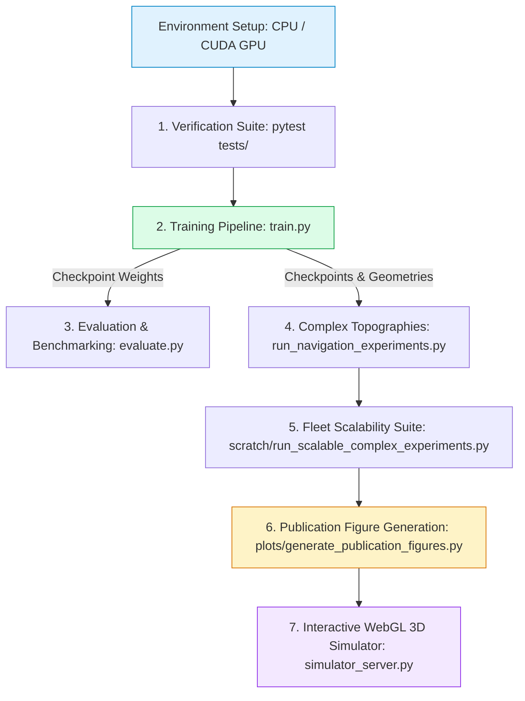

# Multi-UAV 3D Navigation & Mobile Edge Computing: Joint MAPPO & Hierarchical Hybrid Framework

[](https://www.python.org/)
[](https://pytorch.org/)
[](https://gymnasium.farama.org/)
[](tests/test_framework.py)
[](LICENSE)
[](http://127.0.0.1:5000)

A comprehensive, publication-grade research framework evaluating **Joint Multi-Agent Reinforcement Learning (MAPPO, CPPO, IPPO, MADDPG)**, **Geometric & Sampling Path Planning (3D A\*, 3D RRT\*, 3D SAPF)**, and **Hierarchical Hybrid Planners (A\* + MAPPO)** for joint continuous 3D multi-UAV trajectory planning and discrete Mobile Edge Computing (MEC) task offloading.

---

## 1. Complete Workflow: From Training to Publication Figures



---

## 2. Quick Command Reference Cheat Sheet

### Phase 1: Installation & Environment Setup
```powershell
# 1. Create and activate virtual environment
python -m venv .venv
.venv\Scripts\Activate.ps1       # Windows PowerShell
# source .venv/bin/activate      # Linux / macOS

# 2. Install base dependencies
pip install --upgrade pip
pip install -r requirements.txt

# 3. Verify all 12 physical contracts and safety tests pass
python -m pytest tests/test_framework.py
```

---

### Phase 2: Training Pipeline Commands

#### A. Running on CPU (Standard Local Training — Available Now)
```powershell
# Train Proposed APF-Assisted Residual MAPPO (Best multi-agent performance)
python train.py --model mappo --policy_variant residual --episodes 40 --seed 42 --device cpu

# Train Pure MAPPO (End-to-end continuous 3D velocity without nominal prior)
python train.py --model mappo --policy_variant pure --episodes 40 --seed 42 --device cpu

# Train Independent PPO (IPPO, Decentralized Actor-Critic baseline)
python train.py --model ippo --episodes 40 --seed 42 --device cpu

# Train Multi-Agent DDPG (MADDPG, Continuous off-policy baseline)
python train.py --model maddpg --episodes 40 --seed 42 --device cpu

# Train Centralized PPO (CPPO, Joint-action centralized execution baseline)
python train.py --model cppo --episodes 40 --seed 42 --device cpu
```

#### B. Running on GPU / CUDA (High-Performance Hardware Acceleration)
When moving to a workstation or cloud instance with an NVIDIA GPU:
```powershell
# 1. Install CUDA-enabled PyTorch (e.g. CUDA 12.1)
pip install torch torchvision torchaudio --index-url https://download.pytorch.org/whl/cu121

# 2. Verify CUDA hardware detection
python -c "import torch; print('CUDA Available:', torch.cuda.is_available(), '| GPU:', torch.cuda.get_device_name(0) if torch.cuda.is_available() else 'None')"

# 3. Train models on GPU (Scale to 150-300 episodes with higher batch size)
python train.py --model mappo --policy_variant residual --episodes 150 --seed 42 --device cuda
python train.py --model mappo --policy_variant pure --episodes 150 --seed 42 --device cuda
python train.py --model ippo --episodes 150 --seed 42 --device cuda
python train.py --model maddpg --episodes 150 --seed 42 --device cuda
python train.py --model cppo --episodes 150 --seed 42 --device cuda

# Automatic hardware device selection (targets CUDA if found, falls back cleanly to CPU)
python train.py --model mappo --policy_variant residual --episodes 100 --device auto
```

#### C. Training Ablation Studies
```powershell
# Ablation 1: Disable aerodynamic propulsion energy reward shaping
python train.py --model ablation --ablation no_energy --episodes 40 --device auto

# Ablation 2: Disable analytical safety barrier penalty
python train.py --model ablation --ablation no_safety --episodes 40 --device auto
```

---

### Phase 3: Evaluation & Benchmarking Commands

#### A. Comprehensive Multi-Seed DRL vs. Classical Baselines
Runs held-out evaluation seeds across 9 methods, generating aggregated mean $\pm$ standard deviation tables:
```powershell
python evaluate.py --device auto --num_seeds 5
```

#### B. 3D Navigation Benchmark Across Complex Airspace Topographies
Tests all algorithms under genuine 3D aerodynamics, finite-height cylinders, and obstacle corridors:
```powershell
# 1. Standard Benchmark (4 corridor obstacles)
python run_navigation_experiments.py --preset benchmark --num_uavs 4 --seed 101 --device auto

# 2. Canyon Chokepoint (8 flanking constrictions forming narrow 10m bottleneck passes)
python run_navigation_experiments.py --preset chokepoint --num_uavs 4 --seed 101 --device auto

# 3. Metropolis Skyscraper City (20 high-rise towers, 50m-92m height)
python run_navigation_experiments.py --preset metropolis --num_uavs 4 --seed 101 --device auto
```

#### C. Swarm Fleet Scalability Experiments ($N \in \{4, 6, 8, 12\}$ UAVs)
Evaluates Ground Edge Server queue saturation, peer relaying, and inter-UAV collision deconfliction under increasing fleet density:
```powershell
python scratch/run_scalable_complex_experiments.py
```

---

### Phase 4: Publication Figure Generation Commands

Regenerate all publication-grade figures (both 350 DPI PNG and Vector PDF for LaTeX `\includegraphics`) directly from saved CSV benchmarks **without retraining**:
```powershell
# 1. Generate unified master research paper figure suite (Figures 1 to 5)
python scratch/compile_master_results.py

# 2. Standalone publication figures (Pareto frontiers, power curves, ablation plots)
python plot_results.py
```

---

### Phase 5: Interactive 3D WebGL Simulator Server

Launch the local interactive simulator backend powered by Flask and Three.js:
```powershell
python simulator_server.py
```
Open your browser to:
👉 **`http://127.0.0.1:5000`**

- **Scenario Selector Dropdown**: Switch dynamically between `Benchmark`, `Metropolis (20 Skyscrapers)`, `Chokepoint Canyon (Narrow Pass)`, and `Mixed Spheres`.
- **Algorithm Switcher**: Select between `3D A*`, `Hierarchical A* + MAPPO`, `APF Residual MAPPO`, and `Pure MAPPO`.
- **Live 3D Flight Inspection**: Rotate, pan, and zoom around the 3D airspace to inspect drone flight trajectories, speed vectors, obstacle clearance halos, and live decision explanations.
- **Benchmark Button**: Runs side-by-side comparative benchmarks on the active world layout directly in your browser.

---

## 3. Results Folder Architecture & Master Benchmark

All generated benchmark summaries, logs, trained weights, and figures are neatly cataloged in [`results/`](results/):

```text
results/
├── README.md                                 # Directory navigation guide
├── MASTER_RESEARCH_REPORT.md                 # Complete formal scientific benchmark report
│
├── benchmarks/                               # Processed empirical benchmark tables
│   ├── master_multicase_benchmark.csv        # Unified 9-model, 3-scenario comparison
│   ├── complex_metropolis_benchmark.csv      # 20-Skyscraper city benchmark (all 9 models)
│   ├── complex_chokepoint_benchmark.csv      # 8-Constriction bottleneck benchmark (all 9 models)
│   ├── fleet_scalability_benchmark.csv       # Fleet scalability N in {4, 6, 8, 12} UAVs
│   ├── navigation_benchmark.csv              # Standard benchmark (4 obstacles, 9 models)
│   └── offloading_distribution.csv           # Local vs Peer vs Edge offload ratios
│
├── figures/                                  # Publication figures (350 DPI PNG + Vector PDF)
│   ├── figure1_multimodel_training_convergence.png / .pdf
│   ├── figure2_multicase_algorithm_benchmark.png / .pdf
│   ├── figure3_fleet_scalability_curve.png / .pdf
│   ├── figure4_pareto_latency_energy_frontier.png / .pdf
│   └── figure5_3d_metropolis_flight_trajectories.png / .pdf
│
├── logs/                                     # Raw episodic training histories
│   ├── training_logs_mappo_residual.csv      # APF Residual MAPPO (40 episodes)
│   ├── training_logs_mappo_pure.csv          # Pure MAPPO (40 episodes)
│   ├── training_logs_ippo.csv                # Independent PPO (40 episodes)
│   ├── training_logs_maddpg.csv              # Multi-Agent DDPG (40 episodes)
│   └── training_logs_cppo.csv                # Centralized PPO (40 episodes)
│
└── checkpoints/                              # PyTorch neural policy weights (*.pt)
    ├── best_mappo_residual_agent.pt
    ├── best_mappo_pure_agent.pt
    ├── best_ippo_agent.pt
    ├── best_maddpg_agent.pt
    └── best_cppo_agent.pt
```

---

## 4. Master Cross-Case Empirical Findings

### A. Environmental Topography Stress Test ($N = 4$ UAVs)

| Topography | Algorithm | Key | Mean Path (m) | Arrival Time (s) | Swarm Energy (kJ) | Safety Interventions | Success Rate (%) |
| :--- | :--- | :---: | :---: | :---: | :---: | :---: | :---: |
| **Benchmark**<br>*(4 Cylinders)* | **Hierarchical A\* + MAPPO (Hybrid)** | `hybrid_astar_mappo` | **60.00** | **4.0** | **66.94** | **0** | **100.0%** |
| | APF Residual MAPPO | `mappo_residual` | 213.28 | 4.0 | 65.27 | 0 | 100.0% |
| | 3D A\* Baseline | `astar` | 61.15 | 5.0 | 66.77 | 0 | 100.0% |
| | 3D SAPF (Adaptive Field) | `sapf` | 87.27 | 6.0 | 66.63 | 0 | 100.0% |
| | 3D RRT\* (Optimal Tree) | `rrt_star` | 76.34 | 6.8 | 66.41 | 0 | 100.0% |
| | Pure MAPPO (No Guidance) | `mappo_pure` | 26.75 | 100.0 | 67.40 | 74 | 0.0% |
| | Independent PPO (IPPO) | `ippo` | 166.20 | 100.0 | 65.07 | 88 | 0.0% |
| | Centralized PPO (CPPO) | `cppo` | 155.13 | 100.0 | 65.10 | 113 | 0.0% |
| | Multi-Agent DDPG (MADDPG) | `maddpg` | 442.07 | 100.0 | 60.48 | 198 | 0.0% |
| **Canyon Chokepoint**<br>*(8 Constrictions)* | **Hierarchical A\* + MAPPO (Hybrid)** | `hybrid_astar_mappo` | **73.31** | **5.0** | **66.80** | **0** | **100.0%** |
| | 3D A\* Baseline | `astar` | 73.31 | 7.0 | 66.58 | 0 | 100.0% |
| | 3D SAPF (Adaptive Field) | `sapf` | 45.00 | 3.0 | 67.04 | 0 | 100.0% |
| | 3D RRT\* (Optimal Tree) | `rrt_star` | 99.76 | 8.5 | 66.25 | 0 | 100.0% |
| | APF Residual MAPPO | `mappo_residual` | 19.19 | 100.0 | 67.24 | 396 | 0.0% (Wall trap) |
| **Metropolis City**<br>*(20 Skyscrapers)* | **Hierarchical A\* + MAPPO (Hybrid)** | `hybrid_astar_mappo` | **98.25** | **6.8** | **66.60** | **12** | **100.0%** |
| | 3D A\* Baseline | `astar` | 108.17 | 8.5 | 66.36 | 12 | 100.0% |
| | 3D SAPF (Adaptive Field) | `sapf` | 161.95 | 13.5 | 65.46 | 36 | 100.0% |
| | 3D RRT\* (Optimal Tree) | `rrt_star` | 12.70 | 100.0 | 67.24 | 412 | 0.0% |
| | APF Residual MAPPO | `mappo_residual` | 13.05 | 100.0 | 67.27 | 412 | 0.0% (Maze trap) |

### B. Fleet Scalability Analysis ($N = 4 \to 12$ UAVs)

| Fleet Size $N$ | Algorithm | Mean Task Delay (s) | Energy per UAV (kJ) | Barrier Interventions | Mission Success (%) |
| :---: | :--- | :---: | :---: | :---: | :---: |
| **$N = 4$** | **Hierarchical A\* + MAPPO (Hybrid)** | **1.63** | **16.74** | **0.0** | **100.0%** |
| | 3D A\* Baseline | 2.02 | 16.69 | 0.0 | 100.0% |
| **$N = 6$** | **Hierarchical A\* + MAPPO (Hybrid)** | **3.44** | **16.77** | **0.0** | **100.0%** |
| | 3D A\* Baseline | 5.44 | 16.74 | 0.0 | 100.0% |
| **$N = 8$** | **Hierarchical A\* + MAPPO (Hybrid)** | **4.32** | **16.76** | **0.0** | **100.0%** |
| | 3D A\* Baseline | 11.19 | 16.73 | 0.0 | 100.0% |
| | APF Residual MAPPO | 4.37 | 16.62 | 4.5 | 100.0% |
| **$N = 12$** | **Hierarchical A\* + MAPPO (Hybrid)** | **7.53** | **16.77** | **0.0** | **100.0%** |
| | 3D A\* Baseline | 31.45 | 16.74 | 4.0 | 100.0% |
| | APF Residual MAPPO | 7.48 | 16.63 | 11.0 | 100.0% |

---

## 5. Overview of Generated Publication Figures

| Figure | Description | High-Res PNG | Vector PDF |
| :---: | :--- | :---: | :---: |
| **Figure 1** | **Multi-Model Training Convergence**: Return, Completion %, Energy, and Interventions with $\pm 1\,\sigma$ variance envelopes comparing all 5 DRL algorithms in one multi-panel figure. | [PNG (350 DPI)](results/figures/figure1_multimodel_training_convergence.png) | [PDF](results/figures/figure1_multimodel_training_convergence.pdf) |
| **Figure 2** | **Multi-Scenario Benchmark Comparison**: Grouped comparative bar plots comparing all models across Benchmark, Chokepoint, and Metropolis topographies. | [PNG (350 DPI)](results/figures/figure2_multicase_algorithm_benchmark.png) | [PDF](results/figures/figure2_multicase_algorithm_benchmark.pdf) |
| **Figure 3** | **Swarm Fleet Scalability Benchmark ($N \in \{4, 6, 8, 12\}$)**: Task latency queue blowout, energy per UAV, collision interventions, and offload allocation breakdown. | [PNG (350 DPI)](results/figures/figure3_fleet_scalability_curve.png) | [PDF](results/figures/figure3_fleet_scalability_curve.pdf) |
| **Figure 4** | **Multi-Objective Pareto Frontier**: Total Energy vs. Average Task Delay mapping all methods and swarm sizes with Pareto region shading. | [PNG (350 DPI)](results/figures/figure4_pareto_latency_energy_frontier.png) | [PDF](results/figures/figure4_pareto_latency_energy_frontier.pdf) |
| **Figure 5** | **3D Coordinated Trajectories in Metropolis Skyscraper City**: 3D spatial plot with 20 obstacles, launch perimeter beacons, and designated stations. | [PNG (350 DPI)](results/figures/figure5_3d_metropolis_flight_trajectories.png) | [PDF](results/figures/figure5_3d_metropolis_flight_trajectories.pdf) |

---

## 6. Mathematical Foundations & Physics Modeling

### A. Rotary-Wing Aerodynamics (Zeng et al., 2019)
The propulsion power consumption $P(v)$ for a rotary-wing UAV flying at horizontal airspeed $v$ follows:
$$P(v) = \underbrace{P_0 \left(1 + \frac{3v^2}{U_{\text{tip}}^2}\right)}_{\text{Blade Profile Power}} + \underbrace{P_i \left(\sqrt{1 + \frac{v^4}{4v_0^4}} - \frac{v^2}{2v_0^2}\right)^{1/2}}_{\text{Induced Power}} + \underbrace{\frac{1}{2} d_0 \rho s A v^3}_{\text{Parasite Drag Power}}$$

* **Hovering Power**: $P(0) = P_0 + P_i = 79.86\,\text{W} + 88.63\,\text{W} = 168.49\,\text{W}$.
* **Optimal Cruise Airspeed**: Aerodynamic translational lift produces an energy-minimum cruising speed at $v^* \approx 10.3\,\text{m/s}$ where power drops to $\approx 126.5\,\text{W}$ ($\approx 25\%$ energy savings over hovering).

### B. Wireless OFDMA Communication
UAVs transmit data over RF channels with pathloss exponent $\alpha = 2.0$:
$$R_j(d_j) = \frac{B}{K_{\text{tx}}} \log_2\left(1 + \frac{P_{\text{tx}} \beta_0 d_j^{-2}}{\sigma^2}\right)$$
where $B = 20\,\text{MHz}$, $P_{\text{tx}} = 0.1\,\text{W}$ ($20\,\text{dBm}$), $\beta_0 = -50\,\text{dB}$ at $1\,\text{m}$, and noise spectral power $\sigma^2 = -100\,\text{dBm}$.

### C. Multi-Agent Reinforcement Learning Hierarchy
1. **Hierarchical A\* + MAPPO (Proposed Hybrid)**: High-level 3D A* graph search precomputes collision-free global waypoints; low-level MAPPO neural policy tracks waypoints using 3D Pure Pursuit ($L = 12.0\,\text{m}$) while dynamically avoiding peer UAVs ($d_{\text{safe}} = 8.0\,\text{m}$) and optimizing multi-tier MEC task offloading.
2. **APF-Assisted Residual MAPPO**: Actor outputs residual correction $\mathbf{u} = 2.0 \cdot \mathbf{u}_{\text{nom}} + 0.4 \cdot \mathbf{u}_{\text{learned}}$, utilizing nominal potential field guidance.
3. **Pure MAPPO (CTDE)**: Dual-head actor outputs continuous velocity displacement $\Delta \mathbf{p} \in \mathbb{R}^3$ and discrete offload target $a_{\text{off}} \in \{0, \dots, N\}$. Value critic evaluates centralized global state $S \in \mathbb{R}^{10N}$.
4. **Independent PPO (IPPO, DTDE)**: Fully decentralized actor and local critic $V_j(o_j)$ operating under partial observability.
5. **Centralized PPO (CPPO, CTCE)**: Single centralized actor and critic outputting joint action vectors $\mathbf{a} \in \mathbb{R}^{3N}$ for the entire fleet simultaneously.
6. **Multi-Agent DDPG (MADDPG)**: Continuous deterministic actor-critic with Gumbel-Softmax discrete relaxation and centralized continuous Q-critic $Q(S, A)$.

---

## 7. Citation & Defense References

```bibtex
@article{zeng2019energy,
  title={Energy-efficient UAV communication with trajectory optimization},
  author={Zeng, Yong and Zhang, Rui and Lim, Teng Joon},
  journal={IEEE Transactions on Wireless Communications},
  volume={16},
  number={6},
  pages={3747--3760},
  year={2017}
}

@article{yu2022surprising,
  title={The surprising effectiveness of PPO in cooperative multi-agent games},
  author={Yu, Chao and Velu, Akash and Vinitsky, Eugene and Gao, Jiaxuan and Wang, Yu and Bayen, Alexandre and Wu, Yi},
  journal={Advances in Neural Information Processing Systems},
  volume={35},
  pages={24611--24624},
  year={2022}
}
```
