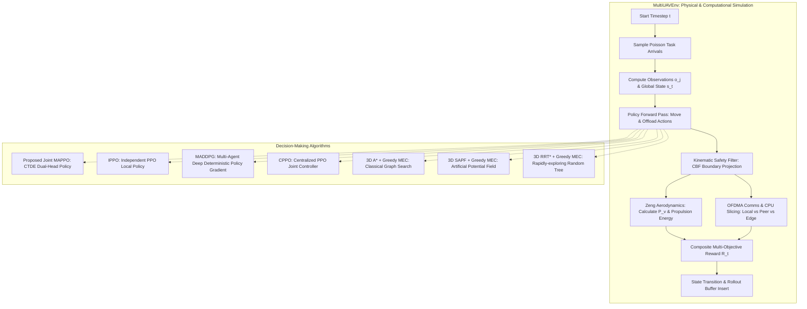

# Project Overview: Autonomous Multi-UAV 3D Path Planning & Edge Computing

## 1. Executive Summary

This research project develops a high-fidelity, physics-grounded 3D simulation framework for coordinated Multi-UAV (Unmanned Aerial Vehicle) fleets performing **simultaneous physical path planning** and **computational task offloading** in dense urban environments (e.g., 20-skyscraper Metropolis canyon).

In modern smart city and disaster-response missions, UAVs are constrained by finite battery reserves while processing real-time compute-intensive workloads (e.g., computer vision, sensor fusion, mapping). The fleet must continuously make coupled physical and computational decisions:
1. **Physical Flight Path Planning**: Navigate through complex 3D airspace populated by cylindrical obstacles from designated start locations to mission stations, avoiding collisions with obstacles and peers while minimizing aerodynamic propulsion power.
2. **Mobile Edge Computing (MEC) Offloading**: For continuous stochastic task arrivals, decide whether each task should be processed on the local on-board CPU, offloaded via cooperative peer-to-peer relay, or transmitted to a Ground Edge Computing Server over a shared RF channel under strict latency deadlines.



---

## 2. Core Subsystems and Architecture

The framework is organized into decoupled, modular components located under `research_v2/`:

```
research_v2/
├── config.py                   # Single source of truth: Airspace, Physics, Comms, MEC, RL configs
├── simulator_server.py         # Flask REST & WebSocket backend serving real-time 3D dashboard
├── train.py                    # Unified MARL curriculum training pipeline with held-out validation
├── evaluate.py                 # Multi-seed (101-105) statistical benchmarking & evaluation suite
├── plot_results.py             # Generates diagnostic curves and comparative charts
├── run_navigation_experiments.py# Specialized 3D obstacle avoidance benchmark runner
├── env/
│   ├── multi_uav_env.py        # Core Gym/Gymnasium 3D multi-agent environment
│   ├── aerodynamics.py         # Physical Zeng et al. (2019) rotary-wing power model
│   ├── comms_compute.py        # Shannon wireless channel, OFDMA slicing, and MEC queues
│   └── safety_filter.py        # Analytical 3D kinematic barrier projection filter
├── models/
│   ├── mappo.py                # Proposed MAPPO (Actor, Critic, GAE, RolloutBuffer)
│   ├── ippo.py                 # Independent PPO (DTDE baseline)
│   ├── maddpg.py               # Multi-Agent DDPG (Off-policy continuous actor-critic)
│   ├── cppo.py                 # Centralized PPO (single agent controlling all UAVs)
│   ├── astar.py                # 3D Grid Graph Search A* Path Planner + Greedy MEC
│   ├── apf.py                  # Sequential Adaptive Potential Field (SAPF) with vortex circulation
│   ├── rrt_star.py             # 3D Rapidly-exploring Random Tree Star Planner
│   └── baselines.py            # Fixed offloading heuristics (Local-Only, Edge-Only, Random)
├── plots/
│   ├── __init__.py             # Public package exports
│   ├── plot_curves.py          # 2D quantitative performance, Pareto trade-off, convergence curves
│   └── render_publication_figures.py # 3D/2D publication trajectory figures (IEEE standards)
├── simulator/
│   └── static/                 # Frontend 3D AeroPlan interactive inspector (Three.js dashboard)
└── tests/
    └── test_framework.py       # 12 rigorous automated unit and regression tests
```

---

## 3. Algorithmic Formulations

### 3.1 Multi-Agent MDP (Markov Decision Process)
The problem is formulated as a Partially Observable Markov Decision Process (POMDP) defined by the tuple $\langle \mathcal{N}, \mathcal{S}, \{\mathcal{O}_j\}, \{\mathcal{A}_j\}, \mathcal{P}, \mathcal{R}, \gamma \rangle$:
- **Fleet Agents**: $\mathcal{N} = \{0, 1, \dots, N-1\}$, default $N=4$ UAVs.
- **Global State Space $\mathcal{S}$**: Concatenation of all UAV positions, velocities, remaining distances, battery state, obstacle vectors, and task backlog ($40$-dimensional).
- **Local Observation Space $\mathcal{O}_j$**: Egocentric local vector observed by UAV $j$ ($20$-dimensional), containing:
  - UAV 3D position $\mathbf{p}_j = [x_j, y_j, z_j]$ normalized by airspace bounds.
  - UAV 3D flight velocity $\mathbf{v}_j = [v_{x,j}, v_{y,j}, v_{z,j}]$ normalized by $v_{\max}$.
  - Relative 3D vector to designated station $\mathbf{p}_{\text{station}, j} - \mathbf{p}_j$.
  - Relative 3D vector to Ground Edge Server $\mathbf{p}_{\text{edge}} - \mathbf{p}_j$.
  - Incoming task attributes (cycles $C$, data size $D$, deadline $T_{\max}$).
  - Persistent local computation queue backlog $Q_j$.
  - Egocentric vector to nearest obstacle $(\Delta x_{\text{obs}}, \Delta y_{\text{obs}})$ and clearance distance $d_{\text{clearance}}$.
- **Action Space $\mathcal{A}_j$**: Hybrid continuous-discrete action pair:
  1. Continuous 3D displacement vector $\Delta \mathbf{p}_j \in \mathbb{R}^3$ constrained to $\|\Delta \mathbf{p}_j\| \le v_{\max} \Delta t$.
  2. Discrete offloading destination index $a_{\text{offload}} \in \{0, 1, \dots, N\}$:
     - $0$: Local on-board execution.
     - $1 \le k < N$: Peer-to-peer cooperative offloading to UAV $(j + k) \pmod N$.
     - $N$: Offloading to Ground Edge Server.

### 3.2 Key Models and Baselines

| Model | Paradigm | Training | Execution | Action Type |
|---|---|---|---|---|
| **Proposed MAPPO** | On-Policy Actor-Critic | Centralized Critic $V(s)$ | Decentralized Actor $\pi(a_j \mid o_j)$ | Continuous 3D Move + Categorical Offload |
| **IPPO** | On-Policy Actor-Critic | Local Decentralized Critic $V(o_j)$ | Decentralized Actor $\pi(a_j \mid o_j)$ | Continuous 3D Move + Categorical Offload |
| **MADDPG** | Off-Policy Actor-Critic | Centralized Critic $Q(s, a_1, \dots, a_N)$ | Decentralized Actor $\mu(o_j)$ | Continuous 3D Move + Continuous Softmax Offload |
| **CPPO** | Centralized Policy | Centralized Critic $V(s)$ | Centralized Single Policy $\pi(a_1, \dots, a_N \mid s)$ | Joint Actions for All UAVs |
| **3D A\*** | Classical Heuristic | None (Deterministic) | Online 3D 26-connected grid search | Manhattan/Euclidean Shortest Path + Greedy MEC |
| **3D SAPF** | Potential Field | None (Deterministic) | Analytical gradient descent | Attractive + Repulsive + Vortex Circulation Field |
| **3D RRT\*** | Sampling Tree | None (Randomized) | Asymptotically optimal geometric tree | Collision-free piecewise linear waypoints |

---

## 4. End-to-End Simulation Data Flow

Each simulation step executes the following verified sequence:
1. **Task Arrival**: Stochastic Poisson arrival generates new tasks with random cycles, data sizes, and deadlines.
2. **Action Generation**: Policies (or classical planners) evaluate observations and generate continuous displacements and offload targets.
3. **Safety Projection**: The analytical kinematic safety filter intercepts proposed positions $\mathbf{p}_{\text{prop}} = \mathbf{p}_t + \Delta \mathbf{p}$. If a trajectory segment intersects any cylindrical obstacle, it calculates the exact entry time parameter $t \in [0, 1]$ via quadratic ray-cylinder intersection and clamps the coordinate safely outside the obstacle boundary.
4. **Physical Integration & Aerodynamics**: Actual flight velocities are integrated: $\mathbf{v} = (\mathbf{p}_{\text{safe}} - \mathbf{p}_t) / \Delta t$. The physical Zeng aerodynamic model computes instantaneous propulsion power $P(v)$ and propulsion energy $E_{\text{prop}} = P(v) \Delta t$.
5. **Wireless Transmission & Slicing**: If offloading, transmission data rate $R$ is determined by Shannon capacity over 3D distance with OFDMA channel slicing. Edge Server CPU frequency $f_{\text{edge}}$ is partitioned among concurrent offloaders.
6. **Task Latency & Queue Updates**: Total latency $T_{\text{delay}} = T_{\text{tx}} + T_{\text{wait}} + T_{\text{comp}}$ is checked against the deadline. Persistent processor queues are updated.
7. **Composite Reward Calculation**: Multi-objective reward balances task completions, deadline penalties, total energy consumption (propulsion + RF + CPU), latency penalties, safety filter intervention penalties, and station progress shaping.
