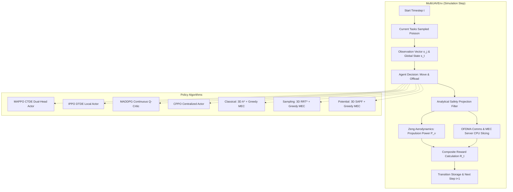

# Multi-UAV Edge Computing Framework Walkthrough

**Project Title:** Deep Reinforcement Learning for Joint Task Offloading and Energy-Efficient Path Planning in Multi-UAV Edge Computing  
**Codebase:** `research_v2`

---

## 1. Project High-Level Architecture

The framework simulates a team of $N=4$ autonomous unmanned aerial vehicles (UAVs) deployed in a 3D airspace containing four cylindrical obstacles. The UAVs must simultaneously solve two coupled problems:
1. **Physical Path Planning:** Fly from initial deployment perimeters around obstacles to assigned mission stations without collisions while minimizing aerodynamic propulsion energy.
2. **Computational Offloading:** Manage incoming Poisson task arrivals by deciding whether to process on the local on-board CPU, offload to a peer UAV, or transmit to the Ground Edge Server to minimize latency and meet deadlines.



---

## 2. Complete Lifecycle: Step-by-Step Execution Sequence

Here is the exact sequence of events from when a script is launched to when publication figures are saved:

### Step 1: Environment Creation & Configuration
- **Script:** `train.py` or `evaluate.py` or `run_navigation_experiments.py`
- Instantiates `MasterConfig()` from `config.py` (airspace bounds, 4 cylinders, communication bandwidth, CPU frequencies, Zeng aerodynamic constants).
- Instantiates `MultiUAVEnv(cfg)`.
- Validates station feasibility (`verify_station_feasibility()`) ensuring target stations are outside obstacle cylinders.

### Step 2: Environment Reset (`env.reset()`)
- Places UAVs in a perimeter ring around the mission center at cruising altitude $z = 50\text{ m}$.
- Sets initial velocities $\mathbf{v}_j = \mathbf{0}$.
- Samples initial Poisson computational tasks for all UAVs.
- Calculates initial observations $o_j \in \mathbb{R}^{20}$ and global state $s \in \mathbb{R}^{40}$.

### Step 3: Agent Action Selection
- For learning models (`MAPPO`, `IPPO`): Local actor network forwards $o_j \to$ Categorical distribution over offloading destinations and Normal distribution over 3D velocity displacement.
- For `MADDPG`: Deterministic actor forwards $o_j \to$ continuous move + Gumbel-Softmax offload vector.
- For `CPPO`: Centralized actor forwards global state $s \to$ joint actions for all 4 UAVs.
- For classical planners (`A*`, `RRT*`, `SAPF`): Computes waypoint direction and evaluates minimum latency/energy MEC destination.

### Step 4: Analytical Safety Filter (`env.safety.filter_trajectories()`)
- Proposes coordinates $\mathbf{p}_{\text{prop}} = \mathbf{p}_t + \Delta \mathbf{p}$.
- If $\mathbf{p}_{\text{prop}}$ penetrates any cylinder obstacle, projects it radially onto the cylinder safety boundary.
- If inter-UAV distance falls below $d_{\text{safe}} = 8.0\text{ m}$, pushes UAVs symmetrically apart.
- Clamps coordinates inside $[0, 200] \times [0, 200] \times [20, 100]\text{ m}$.

### Step 5: Physical Aerodynamics & Computation Processing
- Actual velocity $\mathbf{v} = (\mathbf{p}_{\text{safe}} - \mathbf{p}_t) / \Delta t$.
- Calculates aerodynamic power $P(v) = P_{\text{profile}} + P_{\text{induced}} + P_{\text{parasite}}$ and energy $E_{\text{prop}} = P(v) \Delta t$.
- Gathers offloading choices:
  - If multiple UAVs offload to Edge: OFDMA bandwidth $B / K_{\text{tx}}$ and Edge CPU $f_{\text{edge}} / K_{\text{edge}}$ are dynamically divided.
  - If offloading to Peer: Evaluates air-to-air channel rate and peer CPU sharing.
  - If Local: Evaluates on-board execution at $1.5\text{ GHz}$.
- Checks total delay against task latency deadline.

### Step 6: Reward Calculation & State Transition
- Computes decomposed reward terms:
  $$R_t = R_{\text{task}} + R_{\text{deadline}} + R_{\text{energy}} + R_{\text{delay}} + R_{\text{safety}} + R_{\text{progress}} + R_{\text{station}} + R_{\text{loiter}}$$
- Regenerates new stochastic tasks for the next step.
- Increments timestep $t$. If $t \ge 100$, marks `done = True`.

### Step 7: Experience Recording & Training Update
- In `train.py`: Stores $(o_t, s_t, a_t, \log \pi, r_t, V_t, done_t)$ into `RolloutBuffer`.
- At episode end:
  - Computes Generalized Advantage Estimation (GAE) backwards.
  - Normalizes advantages across the rollout.
  - Performs 5 PPO mini-batch updates with PPO-clip objective on the actor and MSE regression on the centralized critic.
- Checks periodic validation performance across held-out seeds.
- Saves `best_mappo_agent.pt` and `final_mappo_agent.pt` in `results/checkpoints/`.

### Step 8: Multi-Seed Benchmark Evaluation
- In `evaluate.py`: Loads checkpoints and evaluates across test seeds (`[101, 102, 103, 104, 105]`).
- Records detailed per-episode metrics into `results/benchmark_detailed.csv`.
- Aggregates mean $\pm$ standard deviation into `results/benchmark_summary.csv`.

### Step 9: Publication Visualization Generation
- `plots/plot_trajectory_comparison.py`: Generates publication 3D flight trajectories, 2D XY detour corridors, distance convergence, and metric comparison table at 300 DPI (`3d_uav_trajectory_comparison.png` and `.pdf`).
- `plots/plot_curves.py`: Generates training convergence curves, Pareto latency-energy trade-offs, aerodynamic power curves, and offloading distributions.

---

## 3. File Organization Guide

| Directory / File | Core Responsibility | Key Class / Functions |
| :--- | :--- | :--- |
| `config.py` | Single source of truth for all parameters | `MasterConfig`, `AirspaceConfig`, `UAVPhysicsConfig` |
| `env/multi_uav_env.py` | Main Gym-like simulation environment | `MultiUAVEnv.reset()`, `MultiUAVEnv.step()` |
| `env/aerodynamics.py` | Zeng et al. (2019) rotary-wing power model | `AerodynamicsModel.power()`, `AerodynamicsModel.energy()` |
| `env/comms_compute.py` | Shannon capacity, path loss, and MEC queues | `WirelessChannelModel`, `ComputationManager`, `TaskGenerator` |
| `env/safety_filter.py` | Analytical kinematic safety projection | `SafetyFilter.filter_trajectories()` |
| `models/mappo.py` | Proposed Joint MAPPO algorithm (CTDE) | `MAPPOAgent`, `ActorNetwork`, `CriticNetwork`, `RolloutBuffer` |
| `models/ippo.py` | Decentralized Independent PPO baseline | `IPPOAgent`, `LocalCriticNetwork` |
| `models/maddpg.py` | Multi-Agent DDPG baseline | `MADDPGAgent`, `MADDPGActor`, `MADDPGCritic` |
| `models/cppo.py` | Centralized PPO baseline (CTCE) | `CPPOAgent`, `CentralizedActorNetwork` |
| `models/astar.py` | 3D Graph Search A* & Geometric Detour | `AStar3DPlanner`, `GeometricDetourPlanner`, `AStarBaseline` |
| `models/rrt_star.py` | 3D Sampling-based RRT* with rewiring | `RRTStar3DPlanner`, `RRTStarBaseline` |
| `models/apf.py` | Sequential Adaptive Potential Field (SAPF) | `SAPFNavigator`, `SAPFBaseline` |
| `models/baselines.py` | Rule-based and heuristic MEC offloading | `EnergyDeadlineAwareGreedyPolicy`, `LowestLatencyPolicy` |
| `utils/device.py` | Hardware management (GPU/CPU) | `DeviceManager.select_device()`, `print_diagnostics()` |
| `train.py` | Unified training script with validation | `train_mappo()`, `evaluate_validation()` |
| `evaluate.py` | Multi-seed held-out benchmark suite | `run_evaluation()`, `evaluate_episode()` |
| `run_navigation_experiments.py`| Trajectory comparison experiment suite | `run_navigation_suite()` |
| `plot_results.py` | Standalone publication figure regenerator | Standalone entrypoint |
| `tests/test_framework.py` | Automated 7-part test suite | `run_all_tests()` |

---

## 4. How to Run and Reproduce Everything

### 1. Run Verification Test Suite
Verifies that all math, physics, models, checkpoints, and safety filters function correctly:
```bash
python tests/test_framework.py
```

### 2. Run the 3D Trajectory Navigation Benchmark
Executes A*, RRT*, SAPF, MAPPO, IPPO, MADDPG, and CPPO under identical obstacle geometry:
```bash
python run_navigation_experiments.py --seed 101 --device auto
```
- Outputs:
  - `results/trajectory_records.csv` (step-by-step 3D flight coordinates)
  - `results/navigation_benchmark.csv` (path lengths, clearances, success rates)
  - `results/figures/3d_uav_trajectory_comparison.png` (300 DPI visualizer)
  - `results/figures/3d_uav_trajectory_comparison.pdf` (Vector PDF)

### 3. Run Multi-Seed Benchmark Evaluation
Evaluates all learning and classical baselines across 5 independent test seeds:
```bash
python evaluate.py --device auto
```
- Outputs:
  - `results/benchmark_summary.csv` (mean $\pm$ std for completion rate, delay, energy, path length)
  - `results/benchmark_detailed.csv` (raw per-seed episode records)
  - Publication figures in `results/figures/`

### 4. Regenerate All Figures from Saved Records
Regenerates every publication plot without retraining:
```bash
python plot_results.py
```

### 5. Train a Model (e.g., MAPPO)
```bash
python train.py --model mappo --episodes 50 --device auto
```
